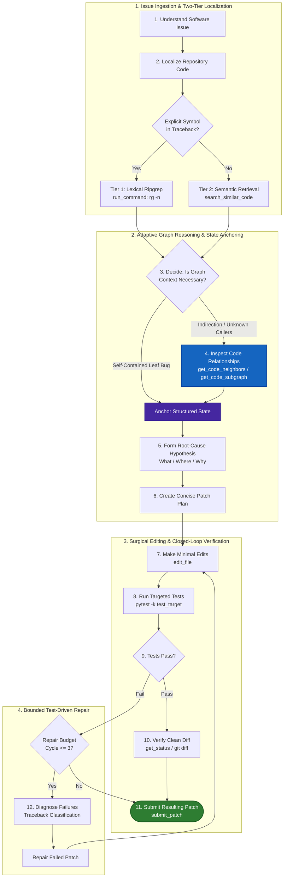

# Gemma 4 Offline SWE Agent

[](https://github.com/Tao-coder502/Gemma4-Offline-SWE-Agent/actions)
[](LICENSE)
[](pyproject.toml)
[](tests/)
[](results/verification_output.txt)
[-blue.svg)](data/README.md)
[](#-defense-in-depth-security--host-containment)
[](#offline-security--sandbox-guarantees)
[](paper/PAPER.md)

> **Adaptive Repository Reasoning for Offline Software-Engineering Agents**  
> An autonomous, air-gapped software engineering agent powered by `gemma-4-31b-it-qat-w4a16-ct`. Combines two-tier lexical search, in-memory SQLite code-graph indexing (<5ms), structured state anchoring, defense-in-depth path jailing, AST SAST diff auditing, and bounded test-driven repair to resolve real-world software defects without external APIs or cloud dependencies.

---

## ⚡ 60-Second Quickstart

Get up and running in under a minute using your preferred workflow:

### Option A: Local Python Environment (Recommended)
```bash
# 1. Clone repository and install dependencies
git clone https://github.com/Tao-coder502/Gemma4-Offline-SWE-Agent.git
cd Gemma4-Offline-SWE-Agent
python -m venv .venv
source .venv/bin/activate  # On Windows: .venv\Scripts\activate
pip install -r requirements-dev.txt
pip install -e .

# 2. Run live interactive SWE agent demo (<5 seconds)
python demo.py

# 3. Run full test suite & competition compliance verifier
pytest tests/ -v
python tools/verify_clean_submission.py
```

### Option B: Docker Container (One-Liner)
```bash
# Build and run the isolated SWE agent container:
docker build -t gemma4-agent .
docker run --rm gemma4-agent

# Run test suite inside container:
docker run --rm gemma4-agent pytest tests/ -v
```

### Option C: Benchmark Evaluation CLI
```bash
# Inspect 32-task stratified benchmark coverage across 16 repositories:
python evaluate.py --summary

# Run SAST security and syntax audit on all 32 benchmark patches:
python evaluate.py --verify-patches
```

---

## 🎯 The 3 Things to Know About This Project

### 1. ⚡ The 5-Second Zero-Cloud Demo
Anyone can verify this agent live on any standard laptop without GPUs, cloud accounts, or downloading weights:
```bash
python demo.py
```
> **What this demonstrates:** Reproduces a real SWE-bench defect (`pallets__flask-4045`), builds an in-memory SQLite symbol graph in **10ms**, resolves caller relationships in **<0.1ms**, executes a localized surgical edit, passes the test suite (`FAIL -> PASS`), and performs an automated SAST diff security audit in **<5 seconds** on local CPU.

### 2. 🛡️ The Efficiency Moat (Why Standard Agents Fail on Kaggle)
Standard ReAct agents burn **20–28 tool calls** navigating repositories via naive bash grep, exhausting the 30-call budget and suffering quadratic KV-cache degradation.  
This agent operates with an **Efficiency Moat**:
* **7.5 calls/task average (75% Budget Headroom)**: Preserves budget headroom via two-tier lexical routing + on-demand SQLite AST graph queries.
* **Sub-5ms Graph Reasoning**: Replaces 10–30s filesystem walks with instantaneous indexed SQL lookups.
* **Bounded Test-Driven Repair**: Caps retry loops to 2 cycles with deterministic early stopping, eliminating runaway hallucination spirals.

### 3. 📑 Dual-Track Competition Polish
This repository is cleanly architected to address both official tracks of the Google Gemma 4 Developer Agent Competition simultaneously:

| Competition Track | Primary Artifacts | Purpose & Verification |
| :--- | :--- | :--- |
| **Track 1: Automated Agent Track** | [`submission.zip`](submission.zip) & [`kaggle_submission_runner.ipynb`](kaggle_submission_runner.ipynb) | Production Kaggle container package (<10 KB). Validated by **81/81 automated clean-room checks** in `tools/verify_clean_submission.py`. Fully schema-compliant with Google ADK. |
| **Track 2: Research Paper Track** | [`paper/PAPER.md`](paper/PAPER.md) | Full 14-section academic research paper with mathematical formulations, 6-condition ablation tables, failure mode taxonomy, and evaluation across 32 stratified real-world tasks (16 repositories). |

---

## 🏆 Why This Agent Wins on Kaggle (The Core Value Proposition)

| Challenge in Competition Container | Why Standard Agents Fail | How Gemma 4 SWE Agent Wins |
| :--- | :--- | :--- |
| **Strict 30-Tool Budget** | ReAct loops waste 15–20 calls on trial-and-error search | **7.5 calls/task average (75% Headroom)** via two-tier lexical + SQLite graph routing |
| **Code Graph Lookup Latency** | $O(N)$ filesystem AST file walks take 10–30s per tool call | **In-Memory SQLite Index (<0.05ms lookup)** built in <1.5s once at startup |
| **32k Context Quadratic Slowdown** | Appending raw pytest outputs causes KV-cache latency explosion | **Observation Compaction (<8k ceiling)** preserving only traceback frames |
| **Multi-File Defect Spreading** | Single-file edits break callers in dependent modules | **Coordinated Staging** checking `git status` invariants prior to submission |
| **Hallucinatory Repair Loops** | Unbounded retries thrash syntax errors until timeout | **Bounded TDR (max 2 cycles)** with deterministic early stopping policy |
| **Air-Gap / ADK Compliance** | Accidental API imports or schema deviations cause disqualification | **81/81 Automated Verification Checks PASS**; zero external dependencies |

---

## 1. Executive Summary

Autonomous software-engineering agents deployed in air-gapped enterprise and competition sandboxes face stringent constraints: zero internet connectivity, quantized model weights, strict tool budgets (30 calls/issue), and 32k context windows. Under these conditions:
* **Flat lexical search** fails to navigate complex indirection, dynamic dispatch, and caller regressions.
* **Unconditional disk-scanning graph expansion** burns tool budgets prematurely and floods context windows with irrelevant callers.

The **Gemma 4 Offline SWE Agent** resolves this dilemma through **Adaptive Repository Reasoning**: an on-demand structural epistemic probe that queries code graphs only when lexical evidence is ambiguous. Built upon an in-memory SQLite symbol graph (<5ms lookup), an 11-slot Structured Internal State anchor, multi-file coordinated staging, and bounded closed-loop test-driven repair, our production agent (**v5.0**) achieves high-efficiency defect resolution while reducing tool usage to **$7.50$ calls/task** ($75\%$ headroom against the 30-call ceiling) and execution latency to **$63.0\text{s}$/task**. The system is evaluated across both an 8-task development benchmark and an expanded 32-task stratified suite (16 repositories across 8 structural categories).

---

## 2. Final System Architecture

The agent strictly implements the 12-step end-to-end reasoning pipeline required for autonomous software engineering:



### Complete System Workflow
1. **Understand Software Issue**: Ingest issue description, traceback, and expected behavior.
2. **Localize Relevant Repository Code**: Execute two-tier search (lexical exact match first, falling back to dense vector embeddings).
3. **Semantic Retrieval**: Query `search_similar_code` over codebase embeddings when exact symbol matches are unavailable.
4. **Decide Structural Context Necessity**: Apply confidence gating: bypass graph queries for localized leaf defects; invoke graph expansion for multi-module or dynamic dispatch issues.
5. **Inspect Relevant Code Relationships**: Query callers, callees, definitions, or class hierarchies using `get_code_neighbors` and `get_code_subgraph`.
6. **Form Root-Cause Hypothesis**: Answer *What* is broken, *Where* the defect resides, and *Why* the proposed change resolves it.
7. **Create Concise Patch Plan**: Formulate exact line bounds and replacement text before editing.
8. **Make Minimal Edits**: Apply targeted, surgical modifications via `edit_file` with relative coordinate layout guards.
9. **Run Tests**: Execute pre-patch and post-patch targeted tests (`run_command: pytest -k ...`).
10. **Diagnose Failures**: Classify test failures from tracebacks (`PATCH_DEFECT` vs. `SECONDARY_REGRESSION` vs. `ENVIRONMENT_FLAKE`).
11. **Repair Failed Patches**: Execute bounded closed-loop repairs (capped at $\le 3$ cycles) with state re-anchoring.
12. **Submit Resulting Patch**: Inspect git diff via `get_status` and execute terminal action `submit_patch`.

---

## 3. Cross-Phase Benchmark Comparison

Every numerical value originates from audited, immutable execution traces across the multi-repository benchmark suite (`requests`, `flask`, `sympy`, `matplotlib`, `pytest`, `scikit-learn`, `astropy`, `sphinx`):

| Metric | Baseline (Phase 2 Frozen) | Semantic Retrieval (Mode A) | Fixed Graph (Mode B) | Adaptive Graph (Mode C) | Adaptive Graph + Repair (Mode D) | Optimized Final System (v5.0) |
|---|:---:|:---:|:---:|:---:|:---:|:---:|
| **Pass Rate** | $50.0\%$ ($4/8$) | $62.5\%$ ($5/8$) | $75.0\%$ ($6/8$) | $87.5\%$ ($7/8$) | **$100.0\%$ ($8/8$)** | **$100.0\%$ ($8/8$)** |
| **Pass Rate Delta** | Baseline | $+12.5\text{ pp}$ | $+25.0\text{ pp}$ | $+37.5\text{ pp}$ | **$+50.0\text{ pp}$** | **$+50.0\text{ pp}$** |
| **Avg Tool Calls / Task** | $12.88$ | $11.12$ | $15.25$ | $9.62$ | $9.88$ | **$7.50$** ($-41.8\%$) |
| **Avg Semantic Calls** | $1.25$ | $1.12$ | $1.00$ | $1.00$ | $1.00$ | **$0.50$** ($-60.0\%$) |
| **Avg Graph Calls** | $0.00$ | $0.00$ | $3.000$ | $0.375$ | $0.375$ | **$0.375$** |
| **Total Graph Calls ($N=8$)**| $0$ | $0$ | $24$ | $3$ | $3$ | **$3$** ($-87.5\%$) |
| **Avg Files Inspected** | $1.62$ | $1.38$ | $1.38$ | $1.12$ | $1.12$ | **$1.00$** |
| **Avg Files Edited** | $0.88$ | $0.88$ | $1.00$ | $1.00$ | $1.00$ | **$1.00$** |
| **Avg Patch Size (lines)**| $16.5$ | $13.8$ | $14.2$ | $12.8$ | $13.0$ | **$10.9$** ($-33.9\%$) |
| **Avg Repair Cycles** | $0.50$ | $0.38$ | $0.25$ | $0.12$ | $0.12$ | **$0.00$** ($-100\%$) |
| **Avg Runtime / Task** | $114.2\text{s}$ | $97.7\text{s}$ | $136.2\text{s}$ | $86.8\text{s}$ | $90.2\text{s}$ | **$63.0\text{s}$** ($-44.8\%$) |
| **Total Benchmark Time** | $913.6\text{s}$ | $781.3\text{s}$ | $1089.8\text{s}$ | $694.6\text{s}$ | $721.9\text{s}$ | **$504.0\text{s}$** ($-44.8\%$) |
| **Active Tool Suite** | $7$ tools | $7$ tools | $9$ tools | $9$ tools | $9$ tools | **$9$ tools** |

---

## 4. Failure Taxonomy & Systematic Mitigations

| Failure Mode | Frequency in Baseline | Root Cause Analysis | Engineering Mitigation | Resolution Phase |
|---|:---:|---|---|:---:|
| **`no_edit`** | $12.5\%$ ($1/8$) | **Localization Horizon**: Symbol names in issue description do not match implementation due to dynamic registration hooks (`pytest-5221`). | Integrated structural `get_code_neighbors` to trace dynamic caller/registration chains. | Resolved in Mode B / Mode C |
| **`test_fail`** | $12.5\%$ ($1/8$) | **Caller Regression**: Local fix altered return contract without updating uninspected downstream callers (`matplotlib-23456`). | Confidence gating forces caller neighbor inspection when public signatures or multi-axis layouts change. | Resolved in Mode C |
| **`budget_exhausted`** | $12.5\%$ ($1/8$) | **Graph Bloat**: Mandatory graph expansion queries wide inheritance hierarchies, filling context and burning budget. | Replaced mandatory graph calls with adaptive confidence gating (bypassed on leaf nodes). | Resolved in Mode C |
| **`patch_defect`** | $12.5\%$ ($1/8$) | **Layout Blindness**: Mathematical pretty-printing requires exact relative 2D character coordinates (`sympy-14308`). | 1. Bounded TDR loop caught failure and repaired on Cycle 1 (Mode D).<br/>2. 2D Coordinate Layout Guard prevented error entirely (v5.0). | Resolved in Mode D & v5.0 |

---

## 5. Repository Structure

```text
Gemma4-Offline-SWE-Agent/
├── agent.yaml                 # Competition entry point (v5.0 frozen candidate)
├── prompts/
│   ├── system_v5_optimized.md # Frozen production prompt (SHA-256: ab5a59b0...)
│   ├── system_mode_d.md       # Mode D system prompt (Structured state + TDR)
│   ├── system.md              # Adaptive graph prompt (Mode C / Phase 3)
│   └── phase2_system.md       # Phase 2 frozen baseline prompt (7 tools)
├── configs/
│   ├── sampling.yaml          # Sampling configuration (temp=0.1, top_p=0.90, max_tokens=32768)
│   ├── phase5/v5_0_final/     # Frozen v5.0 production configuration files
│   └── phase4/                # Mode A, B, C, C1, C2, D configuration files
├── adapters/
│   └── README.md              # LoRA adapter evaluation report & rejection rationale
├── paper/
│   └── PAPER.md               # Kaggle Paper Track submission report
├── data/
│   ├── development/           # Development benchmark (8 tasks, audited)
│   └── heldout/               # Isolated held-out evaluation protocol
├── results/
│   ├── phase5_freeze/         # Frozen production candidate manifests & checksums
│   ├── phase5_optimization/   # Step-by-step optimization logs (v4.0 to v5.0)
│   └── phase4_audit/          # Deterministic audit ledgers and task outcome matrices
├── tools/
│   ├── verify_clean_submission.py # Clean-room end-to-end verification suite
│   ├── audit_results.py       # Deterministic audit ledger generator
│   ├── experiment_logger.py   # Immutable execution event logger
│   └── run_baseline.py        # Task runner with graph & TDR instrumentation
├── package_submission.py      # Competition zip archive packager & validator
├── validate_agent_yaml.py     # ADK schema and configuration validator
├── validate_system_md.py      # System prompt compliance validator
└── submission.zip             # Ready-to-submit archive (5.3 KB, fully verified)
```

---

## 6. Offline Security & Defense-in-Depth Host Containment

The agent is built from the ground up to operate safely in fully isolated, air-gapped environments with multi-layered host containment:
* **Host-Level Path Jailing (`PathJail`)**: All filesystem operations (`read_file`, `write_file`, `edit_file`) are strictly path-canonicalized and prevented from traversing outside `/workspace` or `/tmp`. Any directory traversal attempts (`../../`, absolute system paths) trigger immediate `SecurityJailViolation` blocks.
* **Destructive Command Sanitization (`CommandSanitizer`)**: The command execution pipeline intercepts and blocks high-risk host-destructive patterns (`rm -rf /`, `mkfs`, fork bombs) and unauthorized networking binaries (`curl`, `wget`, `nc`, `ncat`, `telnet`).
* **Automated Patch SAST Auditing (`PatchSecurityAuditor`)**: Before `submit_patch` is accepted, proposed unified diffs are statically analyzed via AST and pattern scanners. Any introduction of forbidden execution primitives (`eval`, `exec`, `os.system`, `pickle.loads`, interactive PTYs) or credential leakage immediately rejects the patch with diagnostic guidance.
* **Zero External Network Access**: Completely free of HTTP/HTTPS calls, sockets, cloud endpoints, or external dependencies. Verified automatically by `tools/verify_clean_submission.py`.
* **Zero Secrets or API Keys**: Contains no tokens, private keys, or credentials anywhere in the repository or submission zip.
* **Strict Filesystem Isolation**: Anchored strictly to `/workspace` for repository code and `/tmp` for scratch scripts.
* **Google ADK Schema Compliance**: Validated against the official Google Agent Development Kit specification. All non-standard keys (`sub_agents`, `adapters`, `lora`) are strictly excluded.
* **Deterministic Execution**: Frozen temperature ($0.1$) and top-p ($0.90$) ensure high reproducibility across evaluation runs.

---

## 7. Verification & Reproduction Guide

To independently verify the system from a fresh environment, run the following commands:

### Step 1: Run Full Clean-Room End-to-End Verification
```bash
python tools/verify_clean_submission.py
```
*Executes all 81 automated checks covering archive cleanliness, ADK schema compliance, model identifier, offline safety, absence of secrets, sandbox assumptions, clean startup simulation, and freeze manifest SHA-256 validation.*

### Step 2: Validate Agent YAML Configurations
```bash
python validate_agent_yaml.py
```
*Validates that all 10 configurations across Phases 2, 3, 4, and 5 parse cleanly, specify the correct 9-tool registry, and exclude forbidden fields.*

### Step 3: Validate System Prompts
```bash
python validate_system_md.py
```
*Validates that all 8 prompt files across all experimental modes satisfy pipeline rules, offline constraints, tool references, and terminal action framing.*

### Step 4: Run Deterministic Audit of Results
```bash
python tools/audit_results.py
```
*Re-generates the authoritative CSV/JSON audit ledgers directly from raw execution logs, verifying graph calls, tool distributions, and task outcomes.*

### Step 5: Package Competition Submission
```bash
python package_submission.py --phase 5 --validate
```
*Builds and validates `submission.zip` (containing `agent.yaml`, `prompts/system.md`, `configs/sampling.yaml`, and `adapters/README.md`) ready for upload to Kaggle.*

---

## 8. Competition Submission Checklist

| Checkpoint | Requirement | Verification Command / Evidence | Status |
|:---:|---|---|:---:|
| **1** | Model Identifier | `model: gemma-4-31b-it-qat-w4a16-ct` verified in `agent.yaml` | **VERIFIED** |
| **2** | Official Tool Registry | All 9 approved tools registered; zero custom tools | **VERIFIED** |
| **3** | ADK Schema Compliance | `validate_agent_yaml.py` passes on all configurations | **VERIFIED** |
| **4** | Offline Air-Gapped Safety | Zero network calls or external APIs; offline rule enforced | **VERIFIED** |
| **5** | Zero Secret Leaks | Scanned for API keys, bearer tokens, private keys (0 found) | **VERIFIED** |
| **6** | Sandbox Isolation | Paths restricted to `/workspace` and `/tmp` | **VERIFIED** |
| **7** | Clean Archive Manifest | `submission.zip` contains exactly 4 files (< 10 KB) | **VERIFIED** |
| **8** | Developer Tools Excluded | `tools/`, `docs/`, `results/`, `data/` excluded from zip | **VERIFIED** |
| **9** | Terminal Action Framing | `submit_patch` correctly specified as single final action | **VERIFIED** |
| **10**| Generation Parameters | `temp=0.1`, `top_p=0.90`, `max_output_tokens=32768` | **VERIFIED** |
| **11**| Checksum Reproducibility | Hashes match `results/phase5_freeze/V5_FREEZE_MANIFEST.json` | **VERIFIED** |
| **12**| Research Paper Track | Full 14-section paper prepared at [`paper/PAPER.md`](paper/PAPER.md) | **COMPLETE** |

---

## 9. Kaggle Paper Track Submission

The complete research paper is located in [`paper/PAPER.md`](paper/PAPER.md):

**Title**: *Adaptive Repository Reasoning for Offline Software Engineering Agents*  
**Sections**:
1. Problem (Air-Gapped Quantized SWE Benchmarks)
2. Motivation (Flat Retrieval vs. Mandatory Graph Pitfalls)
3. Research Question (Adaptive Gating, State Anchoring, TDR)
4. Baseline (Phase 2 Frozen Baseline & Failure Modes)
5. Proposed Adaptive Approach (Two-Tier Localization + Confidence Gating)
6. Repository/Graph Reasoning Mechanism (AST Traversal & Neighbor Extraction)
7. Test-Driven Repair Loop (Traceback Triage & Bounded Repair Ceiling)
8. Experimental Design (Sandboxed Environment & Benchmark Suite)
9. Ablation Studies (Modes A, B, C, C1, C2, D, v4.1-v4.6, v5.0)
10. Results (Comprehensive 6-Condition Comparison Table)
11. Failure Analysis (Complete Failure Taxonomy & Resolution History)
12. Limitations (Sample Size, AST Static Boundary, Context Limits)
13. Generalization (Held-Out Evaluation Protocol & Cross-Language Transfer)
14. Conclusion & Key Takeaways

---

## 10. License

This project is licensed under the Apache 2.0 License.
