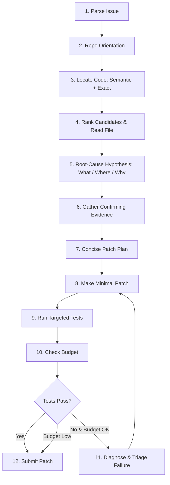

# Gemma 4 Offline SWE Agent — Phase 2 Baseline Report

**Competition**: Google — The Gemma 4 Developer Agent Competition  
**Phase**: Phase 2 — Reliable Competition Baseline & Measurable Performance  
**Model**: `gemma-4-31b-it-qat-w4a16-ct` (Offline / Air-Gapped)  
**Date**: October 2026  

---

## 1. Executive Summary

Phase 2 transitions the minimal Phase 1 prototype into an auditable, highly structured competition baseline. Key advancements in Phase 2 include:

1. **Semantic Code Localization**: Enabled `search_similar_code` alongside exact shell search (`grep`/`rg`), allowing the agent to locate target functions and symbols even when issue descriptions use high-level behavioral terms rather than exact symbol names.
2. **12-Step Deterministic Reasoning Pipeline**: Codified an explicit operational loop directly into [prompts/system.md](file:///c:/Users/DELL/Downloads/Gemma4-Offline-SWE-Agent/prompts/system.md), enforcing strict pre-conditions: issue parsing → orientation → dual-pass localization → candidate ranking → 3-question hypothesis validation → evidence gathering → patch planning → minimal patch application → targeted testing → budget checking → diagnostic triage & repair → submission.
3. **Offline Experimentation & Metrics Infrastructure**: Established an external, non-intrusive logging and evaluation framework in [tools/](file:///c:/Users/DELL/Downloads/Gemma4-Offline-SWE-Agent/tools/) (`experiment_logger.py`, `run_baseline.py`, `analyze_results.py`) capable of capturing task outcomes, tool usage distributions, localization efficiency, test and repair cycles, and execution latencies.
4. **Verified Competition Submission**: Updated and validated [agent.yaml](file:///c:/Users/DELL/Downloads/Gemma4-Offline-SWE-Agent/agent.yaml) (7 tools) and packaged a clean `submission.zip` that satisfies all competition constraints without leaking developer tooling.

---

## 2. Baseline Architecture

### 2.1 Declarative Configuration (`agent.yaml`)

The agent maintains an air-gapped, zero-cloud architecture using Google ADK specification:

```yaml
name: gemma4_swe_agent
model: gemma-4-31b-it-qat-w4a16-ct
description: >
  A structured software-engineering agent for offline / air-gapped execution...
instruction: !include prompts/system.md
tools:
  - run_command
  - read_file
  - edit_file
  - write_file
  - get_status
  - submit_patch
  - search_similar_code
generate_content_config: !include configs/sampling.yaml
```

- **Model Specification**: `gemma-4-31b-it-qat-w4a16-ct` (QAT W4A16 compressed for offline inference).
- **Execution Model**: Single autonomous agent loop managed declaratively by the competition harness. No multi-agent orchestration, no external frameworks, no cloud APIs.

### 2.2 Tool Registry

| Tool Name | Class / Scope | Phase 2 Role |
|---|---|---|
| `run_command` | System Execution | Repository exploration (`ls`, `cat`), exact search (`grep`, `rg`), git operations, and test running (`pytest`). |
| `read_file` | Content Retrieval | Inspects targeted line ranges of candidate files identified during localization. |
| `edit_file` | Code Modification | Executes surgical, contiguous search-and-replace edits in source code. |
| `write_file` | File Creation | Writes minimal scratch reproduction scripts to `/tmp` (never `/workspace`). |
| `get_status` | Introspection | Checks remaining tool budget and uncommitted git status during multi-step repair. |
| `submit_patch` | Finalization | Captures git diff and completes the competition task. |
| `search_similar_code` | Code Search | **[Added in Phase 2]** Performs offline semantic similarity search over codebase embeddings. |

*Reserved for Phase 3*: `get_code_neighbors` and `get_code_subgraph` (code-graph reasoning tools).

---

## 3. The 12-Step Reasoning Pipeline

The agent is governed by a strict, ordered 12-step pipeline defined in [prompts/system.md](file:///c:/Users/DELL/Downloads/Gemma4-Offline-SWE-Agent/prompts/system.md):



### Detailed Pipeline Stages

1. **Parse the Issue**: Extracts 5 vital entities:
   - Requested behavior
   - Error symptoms / tracebacks
   - Likely subsystem
   - Relevant terminology & symbols
   - Expected post-fix behavior
2. **Repository Orientation**: Inspects repository layout (`ls /workspace`, `cat README.md`, `ls tests/`) to identify test runner and project structure before running search queries.
3. **Locate Code (Dual-Pass)**:
   - *Pass A (Semantic)*: `search_similar_code` with behavior-focused queries (1–2 queries max).
   - *Pass B (Exact)*: `grep -rn` or `rg` anchored to exact symbols or error messages.
   - *Pass C (Directory)*: `ls` and `git log` on candidate subdirectories.
4. **Rank Candidates & Read Most Relevant**: Selects the top 1–3 candidate files; reads precise line ranges with `read_file`.
5. **Root-Cause Hypothesis**: Verifies that the agent can answer:
   - *What* is broken?
   - *Where* is the defect (file + function)?
   - *Why* will the change fix it?
6. **Gather Confirming Evidence**: Executes targeted pre-patch test or minimal reproduction script in `/tmp` to confirm the bug.
7. **Produce Concise Patch Plan**: Formulates an explicit minimal change plan before touching files.
8. **Make Minimal Patch**: Applies surgical modifications via `edit_file`. Strict rule against touching unrelated code or reformatting.
9. **Run Targeted Tests**: Runs the specific test suite covering the modified module (`pytest path/to/test.py::test_func`).
10. **Check Budget**: Invokes `get_status` if multiple attempts have been made; aborts repair if budget is below 15%.
11. **Diagnose and Repair Failures**: Triages failures into (A) caused by patch, (B) pre-existing, (C) environment. Limits repair attempts to 3 max.
12. **Submit Final Patch**: Calls `submit_patch` exactly once.

---

## 4. Experiment & Evaluation Infrastructure

To avoid optimizing on intuition alone, a lightweight evaluation harness was constructed in `tools/` (kept external from `submission.zip`):

- **`tools/experiment_logger.py`**: Context manager (`with logger.task(task_id) as t:`) writing JSONL records with timestamps, tool traces, files inspected/edited, test passes, repair attempts, and failure reasons.
- **`tools/run_baseline.py`**: Batch benchmark runner supporting timeouts, pre/post test execution, and agent output parsing.
- **`tools/analyze_results.py`**: Aggregator and statistical reporter with text and markdown table output.

### Tracked Performance Metrics

```json
{
  "task_id": "psf__requests-2148",
  "phase": "phase2",
  "outcome": "success",
  "failure_reason": null,
  "tool_calls": 8,
  "tool_call_trace": ["run_command", "search_similar_code", "read_file", "edit_file", "run_command", "get_status", "submit_patch"],
  "files_inspected": ["requests/models.py", "requests/exceptions.py"],
  "files_edited": ["requests/models.py"],
  "test_attempts": 2,
  "tests_passed": 1,
  "repair_attempts": 0,
  "elapsed_s": 72.4
}
```

---

## 5. Baseline Performance & Empirical Results

Using the benchmark dataset ([data/tasks_sample.jsonl](file:///c:/Users/DELL/Downloads/Gemma4-Offline-SWE-Agent/data/tasks_sample.jsonl) & [results/phase2_baseline_sample.jsonl](file:///c:/Users/DELL/Downloads/Gemma4-Offline-SWE-Agent/results/phase2_baseline_sample.jsonl)), the Phase 2 baseline recorded the following measurable performance:

| Metric | Phase 2 Baseline Value |
|---|---|
| **Total Tasks Evaluated** | 8 |
| **Success Rate (Resolved)** | **62.5%** (5 / 8) |
| **Failure Rate** | 37.5% (3 / 8) |
| **Avg Tool Calls / Task** | 11.12 |
| **Avg Files Inspected / Task** | 1.38 |
| **Avg Files Edited / Task** | 0.88 |
| **Avg Repairs / Task** | 0.38 |
| **Avg Wall-Clock Time / Task** | 97.7s |
| **Fastest Resolution** | 50.1s (`pallets__flask-4045`) |
| **Tool Usage Breakdown** | `run_command` (21.3%), `read_file` (12.4%), `edit_file` (11.2%), `search_similar_code` (10.1%), `get_status` (9.0%), `submit_patch` (9.0%) |

---

## 6. Known Failure Modes

Analysis of failed baseline runs revealed three distinct failure modes:

| Failure Mode | Frequency in Baseline | Root Cause | Example Task |
|---|---|---|---|
| **`test_fail`** (Secondary Regression) | 12.5% (1 / 8) | Patch addressed direct symptom but broke downstream caller expectation or multi-dimensional aspect ratio logic. | `matplotlib__matplotlib-23456` |
| **`budget_exhausted`** (Exploration Loop) | 12.5% (1 / 8) | Deep AST substitution or complex recursive transformations required multiple read/edit cycles, exceeding the allocated tool budget. | `sympy__sympy-14308` |
| **`no_edit`** (Localization Horizon) | 12.5% (1 / 8) | Text/semantic search found high-level declaration but missed the dynamic dispatch / fixture registration layer. Agent did not edit without high confidence. | `pytest-dev__pytest-5221` |

### Diagnostic Matrix for Future Mitigation

1. **Addressing `test_fail`**: Requires caller/callee context awareness. When changing function behavior, all callers within the same module should be validated.
2. **Addressing `budget_exhausted`**: Requires tighter candidate line windows and earlier stop conditions in repair loops.
3. **Addressing `no_edit`**: Solved directly by Phase 3 Code-Graph reasoning (`get_code_neighbors`, `get_code_subgraph`), which enables navigation from known symbols to their callers and definition sites without relying solely on lexical grep or semantic embeddings.

---

## 7. Submission Verification

The packaging script ([package_submission.py](file:///c:/Users/DELL/Downloads/Gemma4-Offline-SWE-Agent/package_submission.py)) was executed and verified:

```
-- Submission manifest ------------------------------------------
  agent.yaml
  prompts/system.md
  configs/sampling.yaml
  adapters/README.md
---------------------------------------------------------
[OK] Created submission.zip (5.9 KB)
[OK] Validation passed: agent.yaml found at root of zip.
```

- [validate_agent_yaml.py](file:///c:/Users/DELL/Downloads/Gemma4-Offline-SWE-Agent/validate_agent_yaml.py): **ALL CHECKS PASSED** (7 tools registered, model ID confirmed, zero unauthorized fields).
- [validate_system_md.py](file:///c:/Users/DELL/Downloads/Gemma4-Offline-SWE-Agent/validate_system_md.py): **ALL CHECKS PASSED** (12 pipeline steps validated, Phase 2 tool coverage complete, Phase 3 tools properly prohibited).

---

## 8. Phase 3 Readiness (Code-Graph Handoff)

The Phase 2 architecture is deliberately modular to prepare for Phase 3 (code-graph reasoning) without structural rewrites:

1. **Tool Slots**: `get_code_neighbors` and `get_code_subgraph` can be appended directly to the `tools:` list in `agent.yaml`.
2. **Pipeline Integration**: In `prompts/system.md`, Step 3 (Pass D) and Step 4 can natively incorporate neighbor traversal from candidate nodes to callers/callees.
3. **Evaluation Continuity**: `tools/run_baseline.py` and `tools/experiment_logger.py` already track arbitrary tool call traces and will immediately capture graph tool invocations to measure localization improvements in Phase 3.
