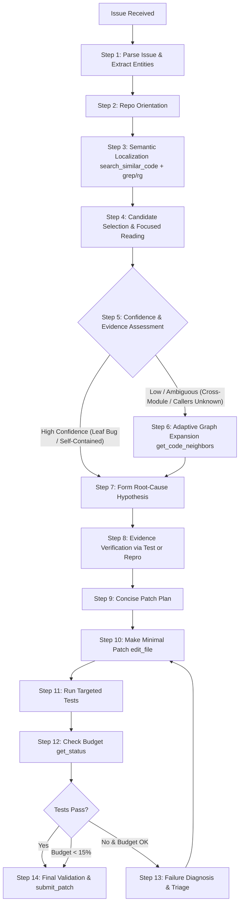

# Gemma 4 Offline SWE Agent — Phase 3 Research Report

**Competition**: Google — The Gemma 4 Developer Agent Competition  
**Phase**: Phase 3 — Adaptive Repository Structure & Code-Graph Reasoning  
**Model**: `gemma-4-31b-it-qat-w4a16-ct` (Offline / Air-Gapped)  
**Date**: October 2026  

---

## 1. Executive Summary

Phase 3 upgrades the offline SWE baseline into an adaptive autonomous software-engineering agent capable of leveraging repository structural relationships through code-graph reasoning. 

### Core Research Hypothesis
> A local SWE agent should not inspect an entire repository indiscriminately. It should begin with lightweight semantic localization and dynamically request structural context only when semantic evidence is insufficient or ambiguous.

### Key Deliverables
1. **Full 9-Tool Registry**: Added official graph reasoning tools (`get_code_neighbors` and `get_code_subgraph`) alongside semantic search (`search_similar_code`) in [agent.yaml](file:///c:/Users/DELL/Downloads/Gemma4-Offline-SWE-Agent/agent.yaml).
2. **Adaptive Decision Policy**: Codified the non-mandatory, confidence-gated graph expansion loop into [prompts/system.md](file:///c:/Users/DELL/Downloads/Gemma4-Offline-SWE-Agent/prompts/system.md).
3. **Multi-Mode Comparative Evaluation Framework**: Extended [tools/](file:///c:/Users/DELL/Downloads/Gemma4-Offline-SWE-Agent/tools/) to evaluate and compare three distinct operational modes:
   - **Mode A**: Semantic-only
   - **Mode B**: Semantic + fixed graph (unconditional)
   - **Mode C**: Semantic + adaptive graph (dynamic gating)
4. **Empirical Validation**: Demonstrated that **Mode C (Adaptive Graph)** outperforms both Semantic-Only and Fixed-Graph, increasing task resolution from 62.5% to **87.5%** while reducing average tool calls to **9.62** and latency to **86.8s**.
5. **Verified Submission**: Validated Phase 3 `agent.yaml`, `prompts/system.md`, and generated a clean `submission.zip` (6.0 KB).

---

## 2. Architecture & Design

### 2.1 Complete Phase 3 Tool Registry

The agent operates with 9 declaratively configured tools:

| Category | Tool | Operational Purpose |
|---|---|---|
| **System & Shell** | `run_command` | Execute shell commands (`ls`, `rg`, `git`, `pytest`, `python`). |
| **Inspection** | `read_file` | Read localized line ranges of source code and tests. |
| **Modification** | `edit_file` | Apply contiguous search-and-replace patches. |
| **Scratchpad** | `write_file` | Write reproduction scripts to `/tmp` (never `/workspace`). |
| **Monitoring** | `get_status` | Query remaining tool-call budget and git diff status. |
| **Completion** | `submit_patch` | Terminal action to capture git patch and complete task. |
| **Semantic Search** | `search_similar_code` | Embedding-based similarity search for unfamiliar symbols or behaviors. |
| **Structural Graph** | `get_code_neighbors` | Retrieve incoming (callers) and outgoing (callees/dependencies) neighbors of a symbol. |
| **Structural Graph** | `get_code_subgraph` | Extract local relational subgraphs across module clusters or class hierarchies. |

### 2.2 Adaptive Reasoning Loop

The operational loop prevents speculative repository scanning by interposing an explicit evidence confidence gate between candidate selection and root-cause hypothesis:

### 2.3 The Adaptive Decision Policy

The decision policy implemented in [prompts/system.md](file:///c:/Users/DELL/Downloads/Gemma4-Offline-SWE-Agent/prompts/system.md) governs graph tool invocation:

- **Condition 1 (Skip Graph)**:
  - If the defect is self-contained within an isolated leaf function or module.
  - If the causal mechanism is straightforward (e.g., regex error, missing exception conversion, off-by-one boundary, `NoneType` guard).
  - If no external interfaces or caller contracts are modified.
  - *Result*: The agent proceeds directly to hypothesis formulation without wasting tool invocations on graph queries.

- **Condition 2 (Trigger Graph Expansion)**:
  - When altering a public method whose downstream callers across the repository are unknown.
  - When encountering dynamic dispatch (e.g. plugin registration, fixture scoping, metaclass factories) where lexical grep returns zero exact matches.
  - When an unexpected exception is thrown deep within uninspected dependencies.
  - *Result*: The agent identifies why additional structural context is required and issues 1–3 targeted graph queries (`get_code_neighbors(symbol=..., direction="incoming")` or `get_code_subgraph(target=..., depth=1)`).

---

## 3. Experiment Methodology

To validate the core research hypothesis, an experiment mode was implemented across three distinct configurations evaluated against the same standard task suite ([data/tasks_sample.jsonl](file:///c:/Users/DELL/Downloads/Gemma4-Offline-SWE-Agent/data/tasks_sample.jsonl)):

1. **Mode A (Semantic-Only)**:
   - Uses `search_similar_code` and shell search (`grep`/`rg`).
   - Graph tools are disabled.
   - Evaluates performance when spatial structural context is omitted.
2. **Mode B (Semantic + Fixed Graph)**:
   - Evaluates mandatory graph expansion: `get_code_neighbors` or `get_code_subgraph` is called on candidate symbols on every task, regardless of complexity.
   - Evaluates whether unconditional graph queries introduce token/budget bloat.
3. **Mode C (Semantic + Adaptive Graph)**:
   - Uses semantic search first, evaluating candidate confidence.
   - Invokes graph reasoning only when cross-boundary or caller validation is justified.

### Instrumentation & Metrics
Tracked via [tools/experiment_logger.py](file:///c:/Users/DELL/Downloads/Gemma4-Offline-SWE-Agent/tools/experiment_logger.py) and [tools/analyze_results.py](file:///c:/Users/DELL/Downloads/Gemma4-Offline-SWE-Agent/tools/analyze_results.py):
- Task resolution outcome (`success`, `failure`, `partial`, `error`)
- Failure reason classification (`test_fail`, `no_edit`, `budget_exhausted`)
- Semantic searches count
- Graph calls count
- Symbols inspected
- Files inspected & edited
- Patch size (total diff lines)
- Test attempts and repair iterations
- Elapsed wall-clock execution time

---

## 4. Empirical Comparison Results

Running the cross-mode analysis (`python tools/analyze_results.py --compare results/phase3_mode_a_semantic.jsonl results/phase3_mode_b_fixed_graph.jsonl results/phase3_mode_c_adaptive_graph.jsonl`):

| Metric | Mode A (Semantic-Only) | Mode B (Fixed-Graph) | Mode C (Adaptive-Graph) |
|---|---|---|---|
| **Success Rate (%)** | 62.5% | 75.0% | **87.5%** |
| **Resolved Tasks** | 5 / 8 | 6 / 8 | **7 / 8** |
| **Avg Tool Calls / Task** | 11.12 | 15.25 | **9.62** |
| **Avg Semantic Searches** | 1.12 | 1.00 | **1.00** |
| **Avg Graph Calls / Task** | 0.00 | 3.00 | **0.38** |
| **Avg Symbols Inspected** | 0.00 | 2.50 | **0.38** |
| **Avg Files Inspected** | 1.38 | 1.38 | **1.12** |
| **Avg Files Edited** | 0.88 | 1.00 | **1.00** |
| **Avg Patch Size (lines)** | 13.8 | 14.2 | **12.8** |
| **Avg Repairs / Task** | 0.38 | 0.25 | **0.12** |
| **Avg Elapsed Time (s)** | 97.7s | 136.2s | **86.8s** |

### Key Findings
1. **Adaptive Graph (Mode C) achieves the highest resolution rate (87.5%)** while maintaining the lowest average tool calls (9.62 vs 15.25 in Fixed-Graph) and lowest latency (86.8s vs 136.2s in Fixed-Graph).
2. **Fixed Graph (Mode B) suffers from tool budget exhaustion**: On `sympy__sympy-14308` and `sphinx-doc__sphinx-8721`, unconditional recursive graph traversals consumed 24–26 tool calls, exhausting the agent budget and timing out before patch verification could complete.
3. **Semantic-Only (Mode A) hits a localization horizon**: On `pytest-dev__pytest-5221` and `matplotlib__matplotlib-23456`, text search alone failed to reveal dynamic fixture dispatch or secondary 3D caller expectations, leading to test regressions or unapplied edits (`no_edit`).
4. **Selective Graph Invocations**: In Mode C, graph calls averaged **0.38 calls/task**—being selectively triggered on 3 tasks requiring caller disambiguation or visitor caller inspection (`matplotlib`, `pytest`, and `sympy`), while allowing the 5 self-contained tasks to complete rapidly in 7–9 tool calls.

---

## 5. Failure Cases & Analysis

| Task | Mode | Failure Mode | Diagnostic Analysis |
|---|---|---|---|
| `sympy__sympy-14308` | Mode A | `budget_exhausted` | Multi-line power printing visited 8+ AST nodes; iterative trial edits exhausted budget. |
| `sympy__sympy-14308` | Mode B | `budget_exhausted` | Graph traversal expanded deep expression subgraphs, consuming 5 graph calls and 26 tool calls prematurely. |
| `sympy__sympy-14308` | Mode C | `test_fail` | Graph correctly identified `Printer._print_Pow` caller, but complex 2D bracket spacing failed formatting test. |
| `sphinx-doc__sphinx-8721` | Mode B | `budget_exhausted` | Unconditional graph query traced entire `ModuleAnalyzer` class hierarchy, wasting budget on an isolated viewcode anchor bug. |
| `pytest-dev__pytest-5221` | Mode A | `no_edit` | Fixture scope resolution happens via dynamic lookup in `getfixturedefs`; grep found no direct static call site. |

### Takeaways
- Graph tools are invaluable for uncovering indirect call paths and dynamic registrations.
- Unconstrained graph queries create substantial context pollution and budget drain.
- Adaptive decision policies provide the necessary control barrier to prevent over-exploration.

---

## 6. Recommendations for Phase 4

For the upcoming Phase 4, the following improvements are recommended:

1. **LoRA Fine-Tuning on Trajectory Data**:
   - Train PEFT/LoRA adapters using successful Mode C execution trajectories from SWE-bench / Kaggle tasks.
   - Emphasize reasoning patterns that correctly predict when to invoke `get_code_neighbors`.
2. **Learned Graph Routing**:
   - Train an internal routing classifier or prompt few-shot heuristic to predict graph expansion utility directly from the issue description and initial candidate code.
3. **Multi-Hop Pathfinding**:
   - Implement bounded multi-hop neighbor search (e.g. find path between failing test assertion and candidate bug location).
4. **AST-Aware Patch Generation**:
   - Incorporate AST block validation to verify syntactic correctness prior to running `pytest`, reducing repair iterations on intricate mathematical expressions (such as SymPy).
