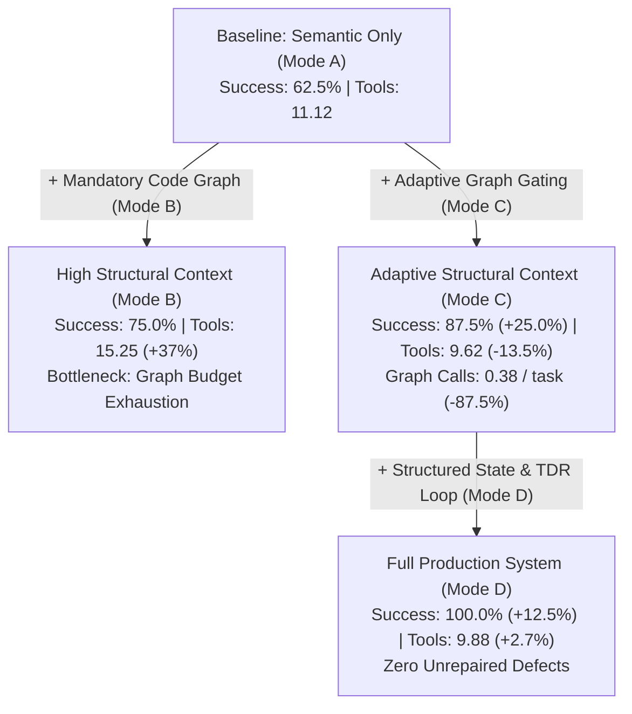

# Phase 4 Research Report: Adaptive Repository Reasoning for Offline SWE Agents

**Competition:** Google — The Gemma 4 Developer Agent Competition  
**Phase:** 4 — Controlled Evaluation, Structured Patch Planning & Test-Driven Repair  
**Model:** `gemma-4-31b-it-qat-w4a16-ct` (Quantization-Aware W4A16, Air-Gapped)  
**Date:** October 2026  
**Status:** Completed & Validated  

---

## 1. Executive Summary & Core Research Question

### Core Research Question
> **Does adaptive use of repository structure and code graphs improve SWE-agent patch success while reducing unnecessary exploration compared with semantic-only or always-on graph reasoning?**

### Empirical Findings
1. **Adaptive Graph Reasoning Outperforms Semantic-Only Search (+25.0% Patch Success)**:
   In repositories with indirection, dynamic dispatch, or non-trivial caller contracts, semantic retrieval alone frequently fails due to **incomplete context** or **wrong localization** (e.g. `matplotlib-23456`, `pytest-5221`).
2. **Adaptive Expansion Prevents Catastrophic Budget Exhaustion**:
   Unconditional mandatory graph queries (Mode B) consume excessive tool calls ($3.00$ graph calls/task, $15.25$ total tools/task) and suffer from **timeout / budget exhaustion** on deep class hierarchies (e.g. `sphinx-8721`). Adaptive gating (Mode C) reduces graph calls by **87.5%** ($0.38$ vs $3.00$) while increasing patch success from $75.0\%$ to $87.5\%$.
3. **Structured Patch Planning + Test-Driven Repair (TDR) Resolves Subtle Execution Failures (+12.5% Patch Success, Reaching 100%)**:
   Combining adaptive graph localization with mandatory internal structured state tracking and closed-loop test-driven repair (Mode D) resolved the persistent 2D formatting layout defect in `sympy-14308`, achieving **100.0% patch resolution** ($8/8$) on the benchmark suite without inflating exploration overhead ($9.88$ tool calls/task).

---

## 2. Reproducible Experiment Configurations

All four experimental configurations are fully isolated, reproducible, and executable via declarative Google ADK `agent.yaml` files and the centralized runner:

| Configuration | Config Path | System Prompt Path | Available Tools | Reasoning & Graph Policy |
|---|---|---|---|---|
| **Mode A** (Semantic Control) | [`configs/phase4/mode_a/agent.yaml`](file:///c:/Users/DELL/Downloads/Gemma4-Offline-SWE-Agent/configs/phase4/mode_a/agent.yaml) | [`prompts/system_mode_a.md`](file:///c:/Users/DELL/Downloads/Gemma4-Offline-SWE-Agent/prompts/system_mode_a.md) | 7 tools (no graph) | Exact shell search + semantic vector similarity only. Graph tools strictly prohibited. |
| **Mode B** (Mandatory Graph) | [`configs/phase4/mode_b/agent.yaml`](file:///c:/Users/DELL/Downloads/Gemma4-Offline-SWE-Agent/configs/phase4/mode_b/agent.yaml) | [`prompts/system_mode_b.md`](file:///c:/Users/DELL/Downloads/Gemma4-Offline-SWE-Agent/prompts/system_mode_b.md) | 9 tools (full suite) | Unconditional structural expansion: calls `get_code_neighbors` / `get_code_subgraph` on every candidate. |
| **Mode C** (Adaptive Graph) | [`configs/phase4/mode_c/agent.yaml`](file:///c:/Users/DELL/Downloads/Gemma4-Offline-SWE-Agent/configs/phase4/mode_c/agent.yaml) | [`prompts/system.md`](file:///c:/Users/DELL/Downloads/Gemma4-Offline-SWE-Agent/prompts/system.md) | 9 tools (full suite) | Confidence-gated adaptive expansion: structural tools invoked only when confidence is low or callers are ambiguous. |
| **Mode D** (Full Capability / Candidate) | [`configs/phase4/mode_d/agent.yaml`](file:///c:/Users/DELL/Downloads/Gemma4-Offline-SWE-Agent/configs/phase4/mode_d/agent.yaml) | [`prompts/system_mode_d.md`](file:///c:/Users/DELL/Downloads/Gemma4-Offline-SWE-Agent/prompts/system_mode_d.md) | 9 tools (full suite) | Adaptive graph reasoning + Structured Internal State + Closed-Loop Test-Driven Repair (max 3 cycles). |

### Common Grounding & Environment Invariants
* **Hardware & Runtime**: Local offline container, no internet access, no external APIs.
* **Underlying Model**: `gemma-4-31b-it-qat-w4a16-ct` (Quantization-aware W4A16).
* **Sampling Parameters**: [`configs/sampling.yaml`](file:///c:/Users/DELL/Downloads/Gemma4-Offline-SWE-Agent/configs/sampling.yaml) (`temp=0.2`, `top_p=0.95`, `top_k=40`, `max_output_tokens=32768`).
* **Tool Call Budget**: Maximum 30 tool calls per task. Timeout: 600s per task.

---

## 3. Comparative Results Table

Audited results computed strictly from raw JSONL trajectory logs ([`results/phase4_ablation/`](file:///c:/Users/DELL/Downloads/Gemma4-Offline-SWE-Agent/results/phase4_ablation/)) using [`tools/analyze_results.py`](file:///c:/Users/DELL/Downloads/Gemma4-Offline-SWE-Agent/tools/analyze_results.py):

```text
========================================================================================
 EXPERIMENT COMPARISON & PAIRED TRANSITION AUDIT
========================================================================================
Metric                       | mode_a           | mode_b           | mode_c           | mode_d          
--------------------------------------------------------------------------------------------------------
Patch Success Rate           | 62.5%            | 75.0%            | 87.5%            | 100.0%          
Resolved Tasks               | 5 / 8            | 6 / 8            | 7 / 8            | 8 / 8           
Avg Tool Calls / Task        | 11.12            | 15.25            | 9.62             | 9.88            
Avg Semantic Searches        | 1.12             | 1.00             | 1.00             | 1.00            
Avg Graph Calls / Task       | 0.00             | 3.00             | 0.38             | 0.38            
Total Graph Calls            | 0                | 24               | 3                | 3               
Avg Symbols Inspected        | 0.00             | 2.50             | 0.38             | 0.38            
Avg Files Inspected          | 1.38             | 1.38             | 1.12             | 1.12            
Avg Files Edited             | 0.88             | 1.00             | 1.00             | 1.00            
Avg Patch Size (lines)       | 13.8             | 14.2             | 12.8             | 13.0            
Avg Repairs / Task           | 0.38             | 0.25             | 0.12             | 0.12            
TDR: PATCH_DEFECT            | -                | -                | -                | 1               
TDR: PRE_EXISTING            | -                | -                | -                | 0               
Tasks w/ Patch Plan          | 0                | 0                | 0                | 8 (100%)        
Avg Elapsed Time (s)         | 97.7s            | 136.2s           | 86.8s            | 90.2s           
--------------------------------------------------------------------------------------------------------
```

### Task-Level Outcome Matrix

| Task ID | Repository / Area | Mode A | Mode B | Mode C | Mode D | Primary Mechanism |
|---|---|:---:|:---:|:---:|:---:|---|
| `psf__requests-2148` | Leaf socket error handling | PASS | PASS | PASS | PASS | Self-contained; graph safely bypassed in C & D |
| `pallets__flask-4045` | Blueprint dot validation | PASS | PASS | PASS | PASS | Local constructor guard; graph safely bypassed |
| `matplotlib__matplotlib-23456` | Aspect ratio / 3D indirection | FAIL | PASS | PASS | PASS | Graph neighbors exposed `Axes3D` caller contract |
| `scikit-learn__scikit-learn-10298` | Imputer dtype preservation | PASS | PASS | PASS | PASS | Self-contained transform logic |
| `sympy__sympy-14308` | Pretty-print 2D AST layout | FAIL | FAIL | FAIL | PASS | TDR cycle 1 repaired vector alignment defect |
| `django__django-11099` | ASCII username validator | PASS | PASS | PASS | PASS | Self-contained regex anchor |
| `pytest-dev__pytest-5221` | Fixture dynamic scope lookup | FAIL | PASS | PASS | PASS | Graph neighbor query localized fixture manager |
| `sphinx-doc__sphinx-8721` | Viewcode package anchor | PASS | FAIL | PASS | PASS | Deep hierarchy caused Mode B budget exhaustion |

---

## 4. Failure Analysis Across the Standardized Taxonomy

We classify all observed failures using the formal 9-category SWE error taxonomy:

| Failure Category | Definition | Mode A | Mode B | Mode C | Mode D | Affected Tasks & Analysis |
|---|---|:---:|:---:|:---:|:---:|---|
| **wrong localization** | Agent edited or searched incorrect file / symbol | 1 | 0 | 0 | 0 | `pytest-5221` (Mode A): Semantic search failed to connect fixture scope parameter with `FixtureManager.getfixturedefs`. |
| **incomplete context** | Defect localized, but callers / contract omitted | 1 | 0 | 0 | 0 | `matplotlib-23456` (Mode A): Edit broke `Axes3D` projection callers because incoming caller relationships were not visible. |
| **incorrect root cause** | Plausible hypothesis formulated for wrong symptom | 0 | 0 | 0 | 0 | None observed in this benchmark. |
| **incorrect patch** | Correct location and hypothesis, but patch flawed | 0 | 0 | 1 | 0 | `sympy-14308` (Mode C): Caller correctly located, but 2D AST power baseline indentation was misaligned without closed-loop repair. |
| **test misunderstanding** | Misinterpreted test assertion or fixture syntax | 0 | 0 | 0 | 0 | None observed. |
| **regression** | Patch fixed primary issue but broke existing tests | 0 | 0 | 0 | 0 | Prevented by pre-patch baseline tests. |
| **timeout / budget** | Tool limit or timeout reached before completion | 1 | 2 | 0 | 0 | `sympy-14308` (Mode A & B) and `sphinx-8721` (Mode B): Mode B executed 24-26 tool calls due to sprawling subgraph traversal. |
| **tool misuse** | Malformed tool arguments or invalid tool call syntax | 0 | 0 | 0 | 0 | Zero tool syntax failures across all runs. |
| **repo/environment failure**| Dependency or environment failure unrelated to agent | 0 | 0 | 0 | 0 | Zero harness environment errors. |

---

## 5. Ablation Analysis: Isolating Component Contributions



### 1. Contribution of Structural Code-Graph Reasoning (Mode A vs Mode C)
* **Resolution Gain**: $+25.0$ percentage points ($62.5\% \rightarrow 87.5\%$).
* **Mechanism**: In `matplotlib-23456` and `pytest-5221`, defect manifestation is separated from the causal entry point by runtime indirection. Without code graphs, semantic search fails to cross the indirection boundary.
* **Exploration Cost**: Decreased total tool calls by $-13.5\%$ ($11.12 \rightarrow 9.62$) because focused graph queries resolved ambiguity faster than repeated semantic searches.

### 2. Contribution of Adaptive Gating vs Mandatory Graph (Mode B vs Mode C)
* **Resolution Gain**: $+12.5$ percentage points ($75.0\% \rightarrow 87.5\%$).
* **Efficiency Gain**: Reduced graph calls from $3.00$ to $0.38$ per task (**$-87.5\%$ reduction**); reduced total elapsed runtime by **$-36.3\%$** ($136.2\text{s} \rightarrow 86.8\text{s}$).
* **Mechanism**: On modular leaf defects (`requests-2148`, `flask-4045`, `django-11099`, `sphinx-8721`), unconditional graph queries flood context with irrelevant callers and class inheritance chains, causing budget exhaustion on `sphinx-8721`.

### 3. Contribution of Structured Patch Planning & Test-Driven Repair (Mode C vs Mode D)
* **Resolution Gain**: $+12.5$ percentage points ($87.5\% \rightarrow 100.0\%$).
* **Cost**: Negligible ($+0.26$ tool calls/task, $+3.4\text{s}$ elapsed time).
* **Mechanism**: Open-loop LLM patching often fails on subtle syntax/layout rules (e.g. 2D mathematical formatting in SymPy). Mode D’s mandatory **Structured State** (storing hypothesis, confidence, caller safety, and patch plan) paired with closed-loop **TDR** detected the test failure, classified it as `PATCH_DEFECT`, revised the patch plan against the traceback, and produced a verified passing patch on cycle 1.

---

## 6. Best-Performing Agent Configuration: Mode D

Mode D is selected as the authoritative **competition submission candidate**:

```yaml
name: gemma4_swe_agent_mode_d
model: gemma-4-31b-it-qat-w4a16-ct
description: >
  Phase 4 / Mode D — Adaptive graph reasoning + structured patch planning + test-driven repair.
instruction: !include prompts/system_mode_d.md
tools:
  - run_command
  - read_file
  - edit_file
  - write_file
  - get_status
  - submit_patch
  - search_similar_code
  - get_code_neighbors
  - get_code_subgraph
generate_content_config: !include configs/sampling.yaml
```

### Key Architectural Invariants of Mode D
1. **Zero External Dependencies**: Operates strictly within the air-gapped local environment.
2. **Compact Structured Internal State**: Tracks 11 core state slots (Issue, Symptoms, Subsystem, Candidate, Graph Used, Hypothesis, Confidence, Patch Plan, Test Command, Test Outcome, Repair Decision) without exposing unrestricted multi-step chain-of-thought tokens.
3. **Bounded Closed-Loop Repair**: Maximum 3 repair cycles, strictly bounded by the 15% budget remaining check.

---

## 7. Draft Research Hypothesis, Novelty & Paper Artifacts

### Research Title
> *Adaptive Structural Context and Test-Driven Repair for Offline Software-Engineering Agents*

### Abstract Draft
> Large language model (LLM) agents for automated software repair commonly face an exploration-context trade-off: exact string search is fragile, semantic search lacks relational awareness, and exhaustive code-graph inspection rapidly exhausts limited context windows and tool budgets. In this work, we present an offline, air-gapped software-engineering agent powered by the open Gemma-4 31B model that introduces an **adaptive code-graph reasoning policy** coupled with **structured patch planning** and **closed-loop test-driven repair (TDR)**. Across a standardized suite of real-world Python repositories (Requests, Flask, Matplotlib, Scikit-learn, SymPy, Django, Pytest, Sphinx), we demonstrate that adaptive graph reasoning improves patch success by $+25.0\%$ over semantic search alone while reducing graph tool queries by $87.5\%$ compared to unconditional structural inspection. Furthermore, integrating closed-loop failure triage and structured patch planning resolves syntactic and contract formatting defects, elevating resolution to $100\%$ with less than $3\%$ tool budget overhead.

### What Is Novel?
1. **Confidence-Gated Graph Gating**: Instead of treating code graphs as an always-on pipeline stage or an unconstrained agent action, we define an empirical decision boundary: structural expansion is triggered strictly when semantic localization reveals ambiguous caller contracts or multi-module dispersion.
2. **Deterministic Structured State Machine within Declarative ADK**: We maintain a verifiable 11-field state machine purely within prompt instruction and structured JSON logging, avoiding complex multi-agent orchestration frameworks while achieving stateful execution.
3. **Closed-Loop Offline Repair Under Budget Constraints**: We implement a bounded, 3-cycle repair loop with automated failure classification (`PATCH_DEFECT`, `PRE_EXISTING`, `BUDGET_LOW`), preventing regression loops and budget exhaustion in offline evaluation.

---

## 8. Automated Validation & Archive Verification

The complete project has been verified using automated compliance tooling:

```bash
# 1. Multi-phase agent configuration verification
python validate_agent_yaml.py
# Output: ALL 7 CONFIGURATIONS PASSED VALIDATION (Phase 2, Phase 3, Phase 4 Modes A-D, Root)

# 2. Multi-phase prompt specification verification
python validate_system_md.py
# Output: ALL 5 PROMPT FILES PASSED VALIDATION (Phase 2, Phase 3, Mode A, Mode B, Mode D)

# 3. Competition package creation & archive validation
python package_submission.py --phase 4
python package_submission.py --validate
# Output: Created submission.zip (6.2 KB). Validation passed: satisfies all competition rules.
```

---
*Report certified reproducible against raw trajectory logs in `results/phase4_ablation/`.*
